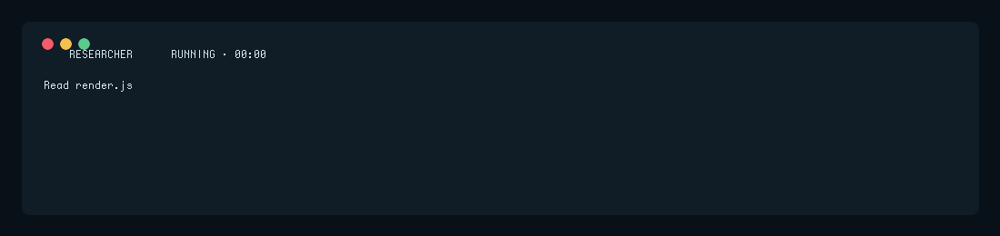

# pi-visual-agents

<p align="center">
  
</p>

A small Pi Coding Agent extension that makes delegated work easier to scan without exposing prompts or secrets.

It adds compact status badges for subagents, safe activity labels, animated running indicators, and inline workflow child rows.

## Features

- Role-aware badges for researchers, reviewers, scouts, workers, oracles, and delegates.
- Accessible text states: `QUEUED`, `RUNNING`, `DONE`, `ERROR`, and `CANCELLED`.
- Animated running state without mutating the transcript.
- Safe activity details for common tools such as `read`, `write`, `edit`, and restricted `bash` commands.
- Workflow child rows read only from the verified `workflowChildren.children` status schema.
- Child summaries derived from validated child IDs; prompts, task text, titles, session names, and private fields are never rendered.
- Unknown child states remain `UNKNOWN` instead of being guessed as active.
- Short retention for finished badges so the UI does not accumulate stale rows.
- A `TYPE /subagents-fleet` hint points to the native `pi-subagents` inspector when multiple runs are visible.

This extension does **not** implement FleetView or register its keyboard shortcut. Install `pi-subagents` if you also want its native inspector and `/subagents-fleet` command.

## Install

### npm

Once published, install the package directly through Pi:

```bash
pi install npm:pi-visual-agents
```

### GitHub

```bash
pi install git:github.com/AxelMrak/pi-visual-agents
```

For reproducible installs, pin a release tag:

```bash
pi install git:github.com/AxelMrak/pi-visual-agents@v0.2.0
```

Restart Pi after installation or package updates so the extension module is loaded from the updated package.

## Use cases

### Scan one delegated run

```text
⟦ ⌕ RESEARCHER ⟧  ◐ RUNNING · 00:00
Read render.js
```

### Monitor a workflow

```text
⟦ • WORKFLOW ⟧  ◓ RUNNING · 00:00                                              TYPE /subagents-fleet
  ✓ REVIEWER · ◓ RUNNING — Review visual agent safety
  ⌁ WORKER · ✓ DONE — Worker step
  ⌖ SCOUT · ! ERROR — Scout step
```

### Handle incomplete status safely

```text
⟦ • WORKFLOW ⟧  ◐ RUNNING · 00:00
  • SUBAGENT · ? UNKNOWN — Workflow task
```

### Animated sandbox demo



The fixtures are generated locally and do not execute agents, expose prompts, or make network requests.

## Architecture

The public entrypoints remain intentionally small:

- `index.js` registers the extension.
- `render.js` exposes renderer helpers used by tests and integrations.
- `src/extension.js` owns Pi lifecycle orchestration.
- `src/status.js` parses and applies verified status snapshots.
- `src/safety.js` contains sanitization and privacy rules.
- `src/render.js` contains presentation logic.
- `src/constants.js` centralizes runtime configuration.

This keeps Pi-specific orchestration separate from parsing, sanitization, and rendering while preserving the existing package API.

## Development

```bash
npm install --ignore-scripts
npm test
npm run check
npm run pack:check
```

CI validates rendering, lifecycle transitions, workflow schema handling, sanitization, syntax, and npm package contents.

## Pi package gallery

`pi-visual-agents` follows the current Pi package contract:

- `package.json` contains the `pi-package` keyword.
- `pi.extensions` explicitly points to `./index.js`.
- Pi runtime packages are peer dependencies rather than bundled dependencies.
- `pi.image` points to the maintained repository logo used by the Pi package gallery.
- The npm tarball explicitly includes the runtime `src/` directory and gallery assets.

The Pi package gallery is built from npm. There is no separate submission form: after `pi-visual-agents` is published to npm, it becomes eligible for automatic indexing at `pi.dev/packages`.

## Privacy and safety

The renderer intentionally avoids displaying task prompts, session names, titles, arbitrary command text, file contents, or secret-like paths. Unknown or malformed values fall back to generic labels. The extension reads local Pi status artifacts to display progress; it does not make network requests or send telemetry.

## License

MIT
